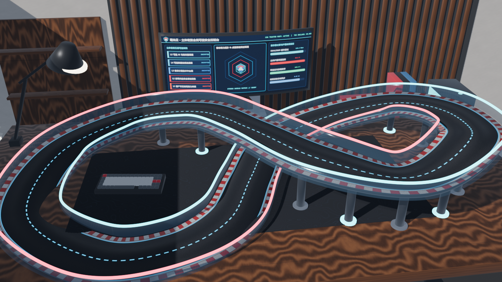

# Desk Racer · 曙光云立体密算版

> **在线试玩地址 (GitHub Pages)**：**[https://tao66175545-boop.github.io/desk-racer-sugon/](https://tao66175545-boop.github.io/desk-racer-sugon/)**

参照 Google 官方《Desk Racer》管线构建的 3D 桌面微缩超算赛车游戏，融合 **Blender 5.2 程序化高精度建模 + BVH 零穿模净空审计 + 2K PBR 材质 + Three.js Selective Bloom + Rapier3D 三维坡道四轮射线悬挂物理 + 自定义 GLSL 全息着色器 + Web Audio 多谐波引擎声浪 + 曙光云“立体密算”五层全息护盾超频机制**。



## 1. 本地快速启动

### 方式一：双击一键启动（Windows 开发环境）
双击项目根目录下的 `start-dev.bat`，自动启动本地开发服务器并在浏览器打开 `http://127.0.0.1:5173/`。

### 方式二：命令行启动
```bash
pnpm install
pnpm dev
```
浏览器访问 `http://127.0.0.1:5173/`。

## 2. 打包与分享给他人

```bash
pnpm build
```
构建产物位于 `dist/` 目录（已配置相对路径 `base: './'` 并内置零依赖便携启动器 `start-game.bat`）：
- **方式 A（推荐 · 在线链接分享）**：直接分享 GitHub Pages 在线链接 `https://tao66175545-boop.github.io/desk-racer-sugon/`，对方无需下载安装任何环境，用电脑浏览器打开即可游玩。
- **方式 B（离线压缩包分享）**：将 `dist/` 文件夹压缩为 `.zip` 发给他人，对方在 Windows 解压后双击里面的 `start-game.bat`（无需安装 Node.js 或 Python），即可自动启动本地微型静态服务并在浏览器打开试玩。

## 3. 局内操作说明

| 按键 | 功能 |
| :--- | :--- |
| `W / A / S / D` 或 `方向键` | 油门加速 / 左右转向 / 刹车与倒车 |
| `Space` | 手刹漂移（高速漂移过弯可持续充能“立体密算”能量） |
| `Shift` / `E` | 激活 **【立体密算 · 全息护盾超频】**（+45% 极速、免擦墙减速、电磁震飞前方桌面障碍） |
| `C` | 切换相机视角（动态追尾 / 引擎盖第一人称 / 桌面微缩全景） |
| `V` | 开关右上角桌面空间参考原图对比窗 |
| `R` | 瞬时复位至最近检查点 |
| `M` | 静音开关 |

## 4. 3D 资产与 PBR 纹理重生成（可选）

```bash
python scripts/generate_pbr_textures.py
"D:/Blender Foundation/blender-5.2.2-windows-x64/blender.exe" -b --python blender/build_race_car.py
"D:/Blender Foundation/blender-5.2.2-windows-x64/blender.exe" -b --python blender/build_start_gantry.py
"D:/Blender Foundation/blender-5.2.2-windows-x64/blender.exe" -b --python blender/build_desk_and_track.py
```
